# 测试用例与运行说明

本说明对应课程「系统验收标准」中的**运行**维度：给出测试用例设计及清单、自动化执行程序与运行方法。版本 v0.1.0（第 1 次阶段性评审，2026-10-08）。

---

## 一、测试范围与环境

| 项 | 内容 |
| --- | --- |
| 被测对象 | 多商品交易闭环（买家提交意向 → 先到先得排队 → 卖家与队首交易 → 该商品冻结 → 登记成功/失败）；单品单卖约束已由挑战 A.1 取消 |
| 测试层次 | HTTP 接口层（自动化，13 个用例）+ 浏览器交互层（手工，5 个用例）+ 挑战升级用例（14 项，见第八章） |
| 测试环境 | Windows；JDK 21.0.10；Maven 3.9.16；Node 22.17.1；后端 `http://localhost:8080`，前端 `http://localhost:5173` |
| 数据环境 | H2 内存数据库，启动时自动初始化卖家账号、示例商品（3 件，含 1 件已下架）与分类树 |
| 测试日期 | 2026-10-07 |

---

## 二、测试数据

| 数据 | 值 |
| --- | --- |
| 卖家账号 | `admin` / `admin123` |
| 初始商品 | 手工牛皮钱包 · 限量定制，￥199.00，状态「在售」 |
| 测试买家 | Buyer1 / 13800000001、Buyer2 / 13800000002、Buyer3 / 13800000003 |

---

## 三、测试用例清单

### 3.1 自动化用例（接口层，由 `scripts/verify-api.ps1` 执行，多商品版 27 项断言）

| 编号 | 用例名称 | 前置条件 | 操作步骤 | 预期结果 | 实测结果 |
| --- | --- | --- | --- | --- | --- |
| TC-01 | 未登录访问卖家接口被拒 | 后端已启动 | 不带 `X-Token` 请求 `GET /api/seller/intents` | HTTP 401，提示未登录 | 通过 |
| TC-02 | 卖家登录返回令牌 | 存在默认账号 | `POST /api/seller/login`，提交 admin/admin123 | `code=0` 且返回 token | 通过 |
| TC-03 | 买家浏览在售商品列表 | 存在可购买商品 | `GET /api/products` | 返回在售商品数组，元素不少于 1 件 | 通过（多商品版） |
| TC-04 | 多商品同时发布 | 已有一件在售商品 | `POST /api/seller/products` 再发一件 | 两件同时在售，不再受「单品单卖」限制 | 通过（多商品版，语义已反转） |
| TC-05 | 提交意向返回唯一口令码 | 存在在售商品 | 连续提交 3 条意向 | 3 条各返回独立口令码 | 通过（3 码互不相同） |
| TC-06 | 先到先得排队位次 | 已提交 3 条意向 | 依次 `GET /api/intents/track?code=...` | 位次依次为 1、2、3 | 通过 |
| TC-07 | 不可跳位 | 队列中有 3 人 | 对第 2 位执行 `POST /api/seller/intents/{id}/start` | 被拒绝，提示「请先到先得」 | 通过 |
| TC-08 | 开始交易自动冻结 | 队列非空 | 对队首执行 start，再查该商品状态 | 交易建立成功；该商品转为 `FROZEN`（其余商品仍在售） | 通过（多商品版） |
| TC-09 | 冻结期间不接受新意向 | 商品已冻结 | 提交新意向 | 被拒绝，提示「商品交易中，暂不接受新的购买意向」 | 通过 |
| TC-10 | 交易成功结算 | 商品已冻结、交易中 | 执行 succeed，再查该商品 | 销量 +1；成交件不重复扣库存；仍有可用库存则回到 `ON_SALE`，归零才 `OFF_SHELF` | 通过（多商品版） |
| TC-11 | 成交后其余意向离开队列 | 队列中还有等候者 | 查询该商品意向列表 | 其余意向进入终态（不再为等候中/交易中） | 通过 |
| TC-12 | 卖家侧不返回口令码 | 已有意向记录 | 卖家接口查询意向列表 | 所有记录 `code` 字段为空 | 通过（0 条泄漏） |
| TC-13 | 下架后口令码失效 | 商品已下架 | 用成交者口令码查询 | 查询被拒绝或 `codeActive=false` | 通过 |

### 3.2 手工用例（浏览器交互层）

| 编号 | 用例名称 | 操作步骤 | 预期结果 | 实测结果 |
| --- | --- | --- | --- | --- |
| TC-14 | 凭口令码修改联系方式 | 买家端提交意向取码 → 查询页改姓名电话 | 修改成功，排队位次不变 | 通过 |
| TC-15 | 买家撤销意向 | 凭口令码执行撤销 | 意向转为「已撤销」，其后排队者位次前移 | 通过 |
| TC-16 | 交易失败恢复在售 | 冻结后卖家标记交易失败 | 商品转「已恢复在售」，可继续接收意向 | 通过 |
| TC-17 | 失败后重新排队 | 对失败意向执行重新排队 | 沿用原口令码，位次重置到队尾 | 通过 |
| TC-18 | 卖家修改密码 | 后台提交原密码 + 新密码 | 校验原密码，新密码生效 | 通过 |

> 3.2 的实测结果与详细过程记录见 `docs/端到端验证记录.md`（2026-10-07 手工验证）。

---

## 四、自动化执行程序

### 4.1 脚本位置与用途

```
scripts/verify-api.ps1          # 多商品版（v0.3.0 起，27 项断言）
scripts/verify-api-sprint1.ps1  # Sprint 1「单品单卖」基线版（留档，不再维护）
```

多商品版按「登录 → 浏览在售列表 → 连续发布两件商品 → 三条意向排队 → 预占库存校验 → 跳位拦截 → 队首开始交易 → 冻结保护 → 登记成交（落定与释放）→ 归零自动下架 → 手动下架与口令码失效 → 交易历史 → 分类编辑」的顺序逐项断言，输出 PASS/FAIL 与汇总，退出码 0 表示全部通过。

脚本具备幂等性：每轮自动创建库存为 5 与 1 的两件测试商品，不依赖已有数据，因此可反复执行；执行后这两件商品分别处于「已手动下架」与「库存归零自动下架」状态，不影响原有商品。

> 与基线版的差异：`TC-04` 由「发布第二件被拒」反转为「可同时发布多件」；`TC-08` 由「在售列表为空」改为「该商品状态为 FROZEN」；`TC-10` 成交后不再一律下架，仍有库存回到 `ON_SALE`。新增 `TC-14` 分类编辑、`TC-15` 交易历史、`TC-16` 预占库存、`TC-17` 归零自动下架。

### 4.2 运行方法

```powershell
# 1) 先启动后端
cd backend
mvn spring-boot:run

# 2) 另开终端执行自检
cd ..
powershell -ExecutionPolicy Bypass -File scripts\verify-api.ps1
```

### 4.3 最近一次执行结果（2026-11-05，多商品版）

```
=== Pingxixi multi-product API self-check (v0.3.0) ===
  [PASS] TC-01 seller API rejects anonymous request
  [PASS] TC-02 seller login returns token
  [PASS] TC-03 buyer reads on-sale product list
  [PASS] TC-04a publish first item succeeds
  [PASS] TC-04b publish second item succeeds (multi-product)
  [PASS] TC-04c both items are on sale at the same time
  [PASS] TC-05 three intents get three distinct codes
  [PASS] TC-16 stock is reserved on submit (5 -> 2)
  [PASS] TC-06 queue positions are 1/2/3 (first come first served)
  [PASS] TC-07 starting trade with non-head intent is rejected
  [PASS] TC-08 head starts trade and product turns FROZEN
  [PASS] TC-09 new intent rejected while frozen
  [PASS] TC-10a trade success returns ok
  [PASS] TC-10b sales increments to 1
  [PASS] TC-10c sold unit is settled, the other two reservations released (expect 4)
  [PASS] TC-10d product returns ON_SALE while stock remains
  [PASS] TC-11 other intents leave the queue after success
  [PASS] TC-12 seller side hides buyer access codes
  [PASS] TC-15a product history returns all intents
  [PASS] TC-15b anonymous buyers have null customerId
  [PASS] TC-15c succeeded record is kept in history
  [PASS] TC-17a intent on last stock is accepted
  [PASS] TC-17b stock reaches 0 and product goes OFF_SHELF automatically
  [PASS] TC-13a manual off-shelf returns ok
  [PASS] TC-13b access code becomes invalid after off-shelf
  [PASS] TC-14a rename category succeeds
  [PASS] TC-14b category restored to original name

=== 27 passed, 0 failed ===
```

> Sprint 1 基线版的历史执行结果为 14 项全过（2026-10-07），脚本已留档为 `scripts/verify-api-sprint1.ps1`。

---

## 五、运行时的手工验证路径（评审现场演示用）

1. `启动pingxixi.bat` 启动前后端；
2. 打开 `http://localhost:5173`，在在售商品列表中选一件，点击购买并填写姓名、电话，**记录返回的口令码**；
3. 打开 `http://localhost:5173/track`，输入口令码查询排队位次；
4. 再提交两条意向，验证位次分别为第 2、3 位；
5. 打开 `http://localhost:5173/login`，用 `admin` / `admin123` 登录卖家后台；
6. 在「意向管理」中对非队首执行开始交易，页面应提示「请先到先得」；
7. 对队首执行开始交易，商品自动变为「已冻结」；此时买家端提交新意向会被拒绝；
8. 点击「交易成功」，商品转为「已下架」；用步骤 2 的口令码查询，提示已失效；
9. 重新发布下一件商品，验证可以继续下一轮。

---

## 六、运行界面截图（2026-10-21 复测）

> 2026-10-21 在本机重新启动前后端，对 13 个接口用例复测**全部通过（14 passed, 0 failed）**，并对下列界面截图存档（图片位于 `docs/wiki/screenshots/`）。

### 买家端

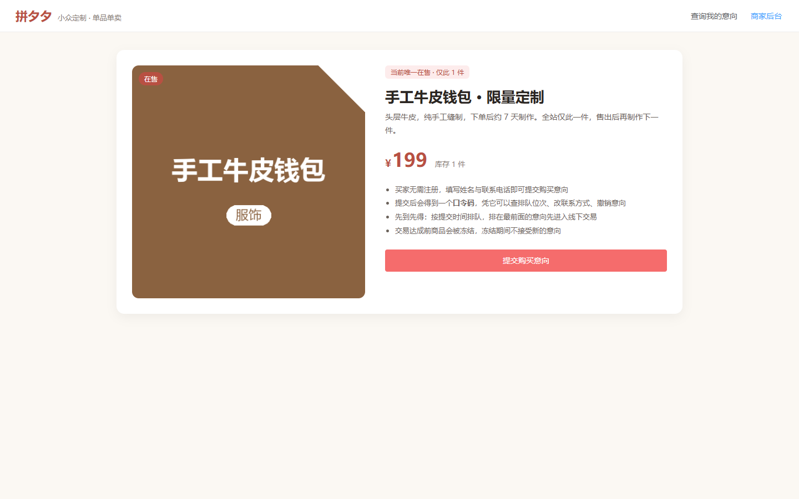

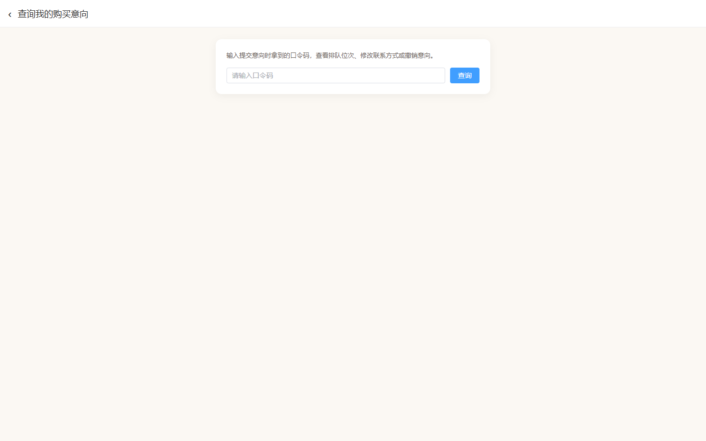

### 卖家端

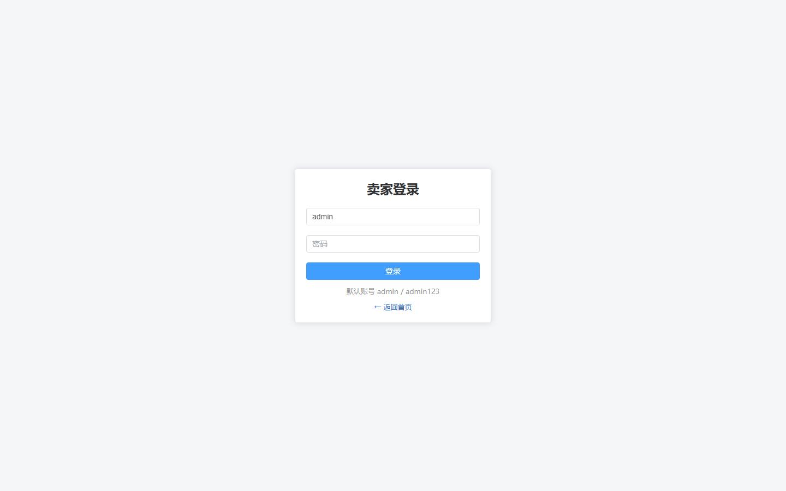

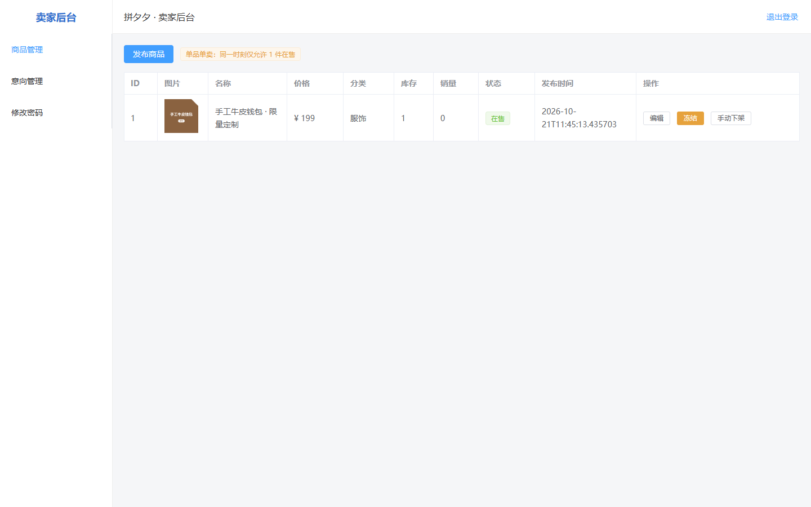

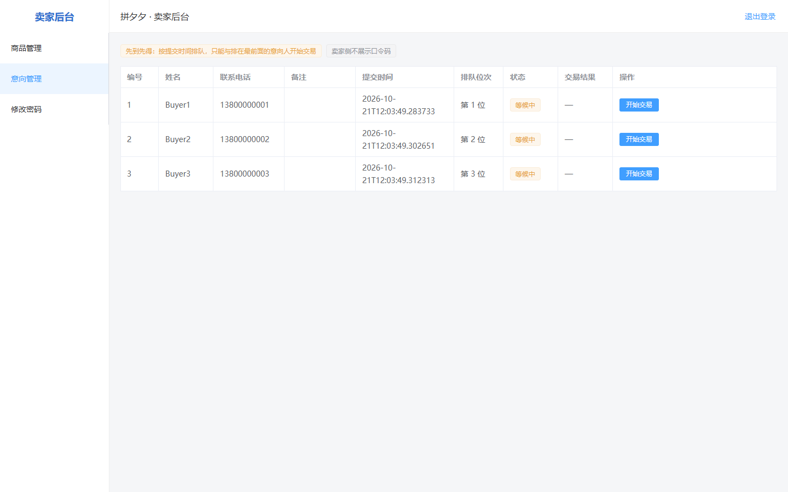

---

## 七、已知偏差与未覆盖项

### 7.1 实现与需求澄清结论的偏差（待处理）

| 项 | 澄清结论 | 当前实现 | 影响 |
| --- | --- | --- | --- |
| 成交后其余意向的终态 | 统一为「失败」 | 置为 `VOID`（已作废） | 状态名称与需求表述不一致，建议后续统一（改代码或改需求措辞） |

该偏差已在自动化脚本中以「离开队列」为判定口径，不影响主流程可用性，但建议 Sprint 2 统一。

### 7.2 尚未覆盖

| 项 | 说明 |
| --- | --- |
| 浏览器自动化与录屏 | 接口层自动化 + 界面截图已补齐（见第六章，2026-10-21）；课程要求的运行录屏尚待补充 |
| 并发场景 | 同一商品并发提交意向、并发冻结的压测未做 |
| 历史商品浏览页 | 功能未实现，无法测试（已顺延 Sprint 2） |

---

## 八、挑战升级（A.1 / A.2）测试用例（2026-10-22 新增，2026-11-04 补充）

> 2026-10-22 完成 A.1 商品管理升级与 A.2 客户升级（提交 `4f2fde7`），2026-11-04 补充分类管理（提交 `f348b19`）与商品交易历史（提交 `7c9b48c`）两条用例。

### 8.1 A.1 商品管理升级

| 编号 | 用例 | 预期 | 结果 |
| --- | --- | --- | --- |
| TC-A1-01 | 卖家连续发布多件商品 | 多件商品同时存在，不再受「单品单卖」限制 | 通过（发布后卖家商品数由 3 增至 4） |
| TC-A1-02 | 商品设置一级 + 二级分类 | 分类树返回 3 个一级分类及其子分类；商品保存两级分类 | 通过 |
| TC-A1-03 | 成交扣减库存 | 交易成功后库存 -1 | 通过（库存由 1 变为 0） |
| TC-A1-04 | 库存归零自动下架 | 库存为 0 时商品状态变为「已下架」 | 通过（`OFF_SHELF`） |
| TC-A1-05 | 浏览与搜索 | 首页返回全部可购买商品；关键词/分类可筛选 | 通过 |
| TC-A1-06 | 多图与富媒体 | 商品支持多张图片；描述按 HTML 渲染 | 通过 |
| TC-A1-07 | 分类管理（新增 / 改名 / 删除） | 卖家后台「分类管理」页可新增一/二级分类、重命名与删除；同级重名被拒绝；一级分类下仍有子分类时删除被拒绝 | 通过（改名接口返回 `code=0`；重名返回「同级分类已存在」） |
| TC-A1-08 | 卖家按商品查看交易历史 | `GET /api/seller/products/{id}/history` 返回该商品全部意向（含终态记录）；匿名买家 `customerId` 为空，注册客户带用户名 | 通过（同一商品返回 2 条：匿名 1 条、注册客户 1 条） |

### 8.2 A.2 客户升级

| 编号 | 用例 | 预期 | 结果 |
| --- | --- | --- | --- |
| TC-A2-01 | 客户注册 | 用户名唯一，密码至少 6 位，保存电话与默认交易地点 | 通过 |
| TC-A2-02 | 客户登录 | 返回客户 token，可访问个人信息 | 通过 |
| TC-A2-03 | 客户下单关联 | 携带客户 token 下单，订单记录关联该客户 | 通过（口令码 `JB6L9ZS8`） |
| TC-A2-04 | 客户查看历史下单 | 返回该客户的下单记录 | 通过（1 条） |
| TC-A2-05 | 商家查看客户 | 卖家接口返回全部注册客户（不含密码） | 通过（3 个） |
| TC-A2-06 | 商家查看客户购买历史 | 按客户 ID 返回其下单记录 | 通过 |

### 8.3 执行方式

- 测试执行：方浩昱（后端②）负责 14 项接口用例的联调与实测；戴英杰（测试）负责升级后的界面走查与端到端验证，并复核用例结果；
- 后端 `mvn compile`、前端 `npm run build` 均通过；
- 接口联调使用 PowerShell 脚本依次调用上述接口，2026-10-22 实测 12 项通过；2026-11-04 补充实测 TC-A1-07、TC-A1-08 两项通过；
- 升级后的界面截图见 `docs/wiki/screenshots/`（06 ~ 12），由方浩昱与戴英杰走查后留存。

### 8.4 升级后界面截图

**买家端**

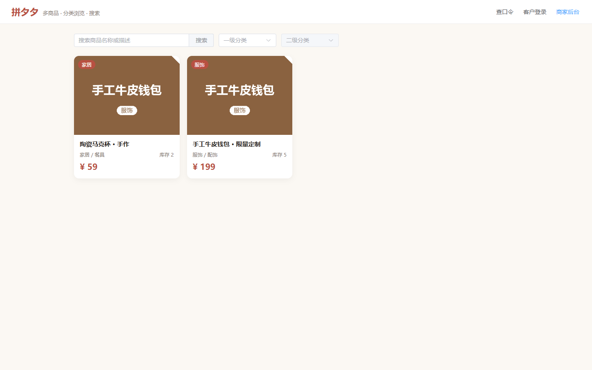


**客户账号**

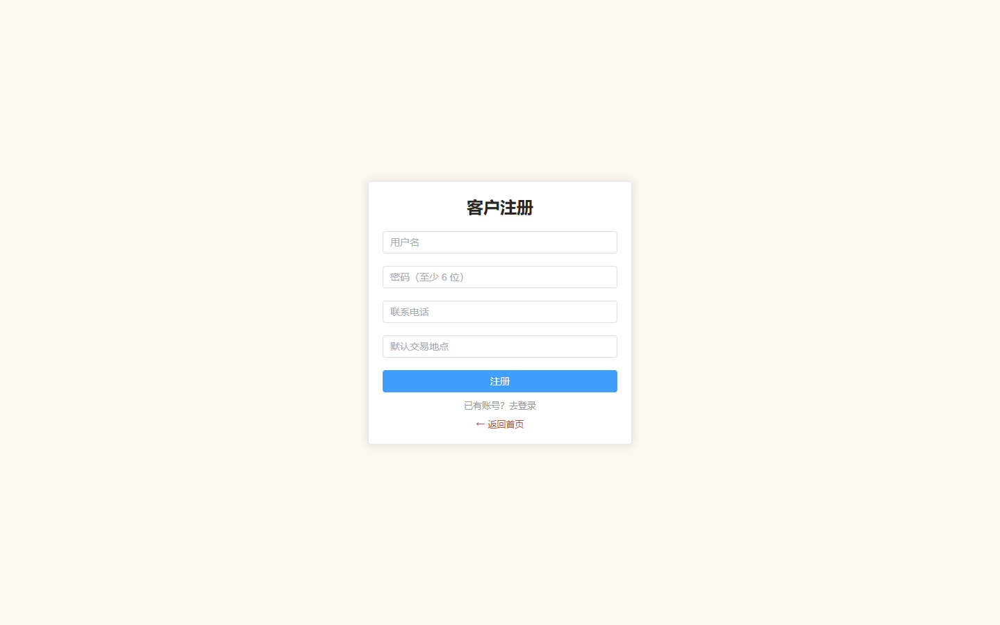

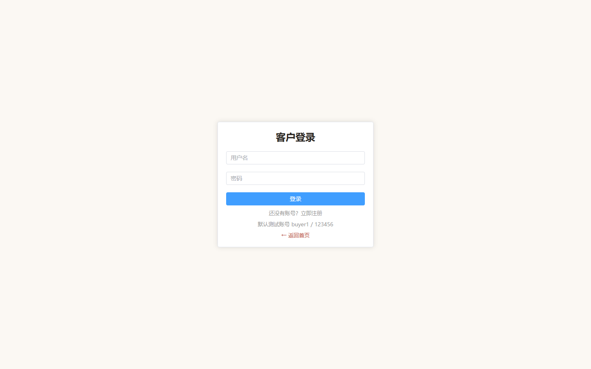

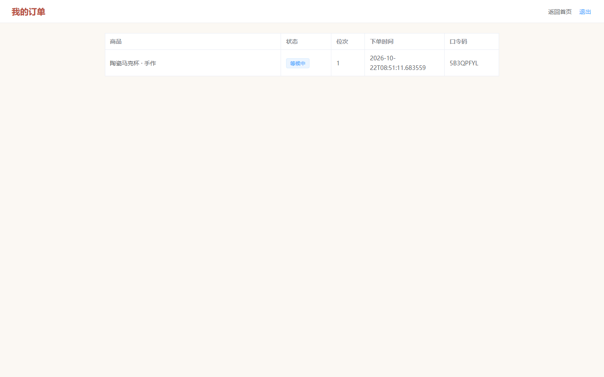

**卖家后台**

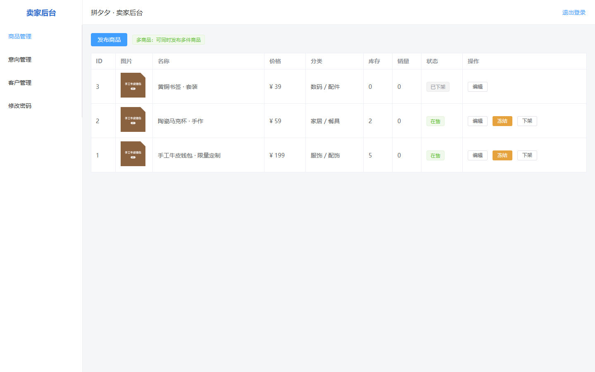

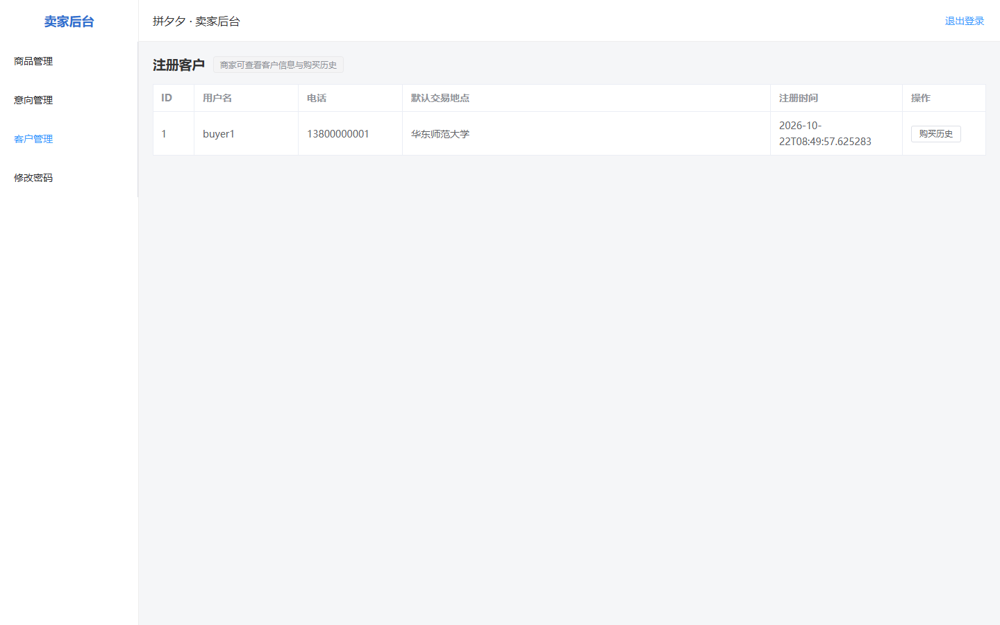
