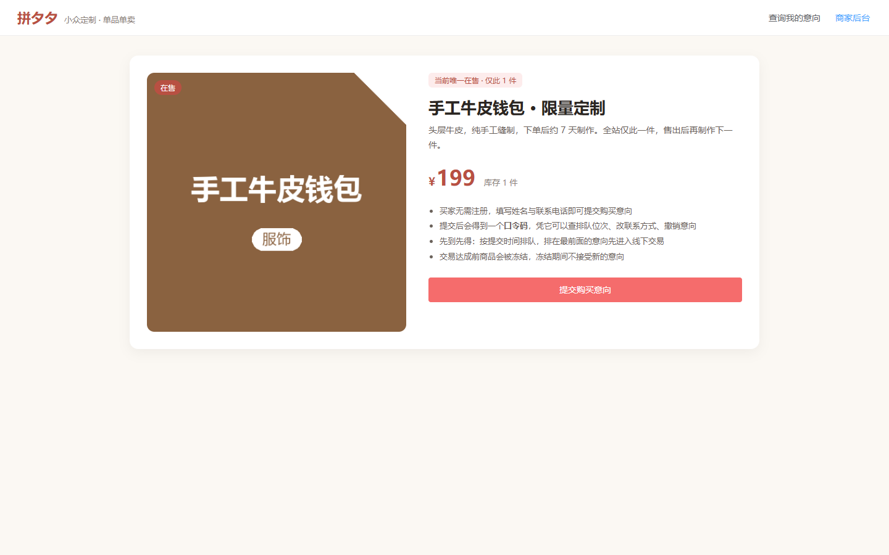
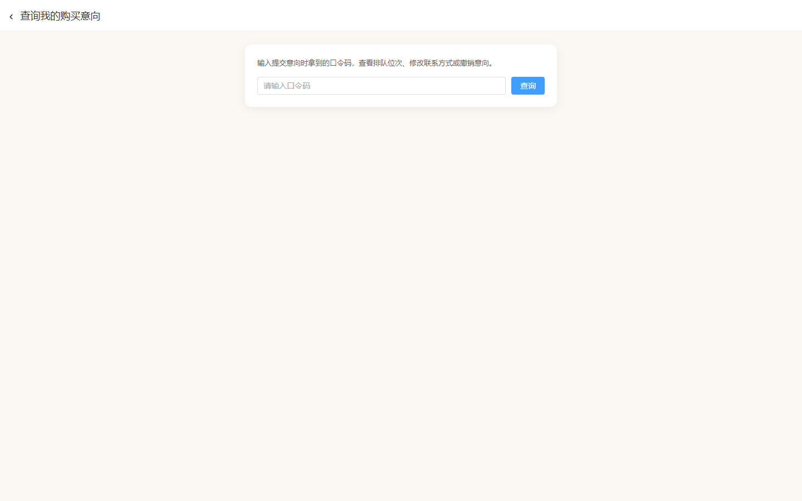
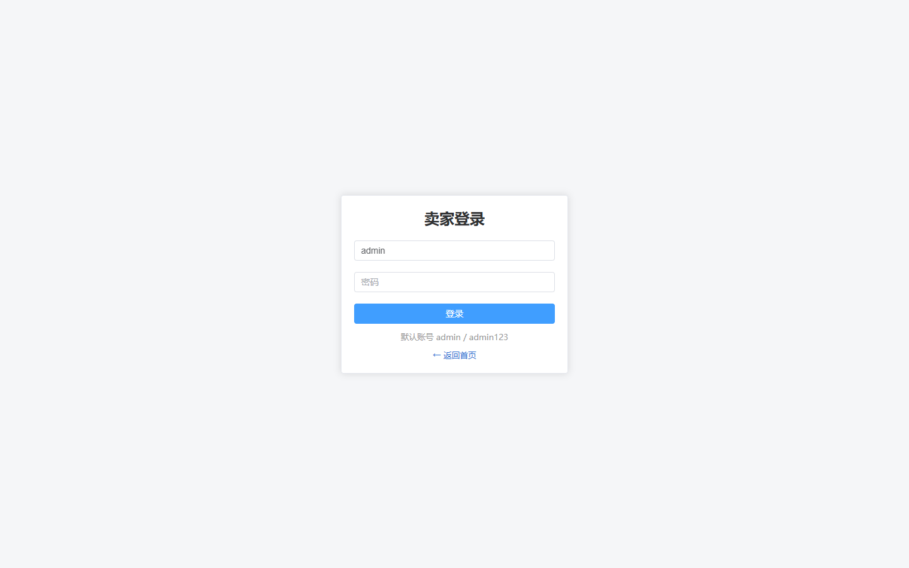
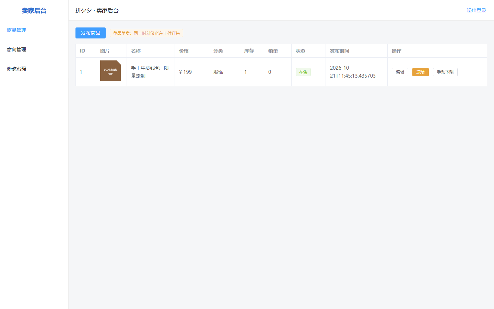
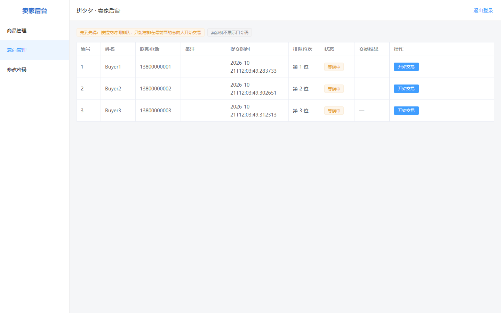

# 第 2 次阶段性评审报告

## 基本信息

- 报告期次：第 2 次
- 报告日期：2026-10-21
- 项目组号：第 4 组
- 项目名称：在线购物系统（拼夕夕 PinXixi）
- 组长：何易

## 评审范围与依据

本次评审在 Sprint 1 交付物基础上，对**运行态**进行二次复测与界面验证，作为 Sprint 1 收尾确认：

1. 后端 Spring Boot 服务（:8080，H2 内存库，启动时自动初始化在售商品）与前端 Vue 应用（:5173）均重新拉起；
2. 运行接口自检脚本 `scripts/verify-api.ps1`，验证单品单卖交易闭环；
3. 使用浏览器自动化对关键页面截图，作为 UI 层验证证据；
4. 核对测试用例与运行说明、端到端验证记录中的结论是否仍可复现。

## 当前迭代状态

- **Sprint 1（2026-09-28 ~ 2026-10-09）已交付并完结**：单品单卖交易闭环在 PC 端跑通，可演示。
- **2026-10-21 复测**：对运行态重新执行 14 项接口断言与 5 个界面验证，**全部通过**，说明第一次评审的交付物在当前环境下仍可完整复现。

## 一、迭代目标达成情况（对照 Sprint 1 八项目标）

| # | 目标 | 达成状态 | 验证证据 |
| --- | --- | --- | --- |
| 1 | 单品单卖：同一时刻最多 1 件在售，库存恒为 0/1 | 已达成 | 接口用例 TC-04（已有在售时禁止发布第二件） |
| 2 | 商品四态状态机（在售/已冻结/已下架/已恢复在售） | 已达成 | 接口用例 TC-08（队首交易自动冻结）、TC-10/11（成功下架 / 失败恢复） |
| 3 | 买家免注册提交意向 | 已达成 | 接口用例 TC-03、TC-05；界面截图 01/02 |
| 4 | 口令码机制（查位次、改信息、撤销、失效） | 已达成 | 接口用例 TC-05、TC-12（卖家侧不可见）、TC-13（失效） |
| 5 | 先到先得队列（队首交易、自动冻结、其余作废） | 已达成 | 接口用例 TC-06（位次 1/2/3）、TC-07（非队首禁交易） |
| 6 | 交易结果登记（成功下架 / 失败恢复 / 作废 / 重排） | 已达成 | 接口用例 TC-10、TC-11、TC-12 |
| 7 | 卖家后台（登录鉴权、商品/意向管理、改密、图片） | 已达成 | 接口用例 TC-01（401 鉴权）、TC-02（登录）；界面截图 03/04/05 |
| 8 | 回归基线（移除购物车与订单模块） | 已达成 | 前端路由与实体已清理，界面截图 01/04 印证 |

> 结论：**Sprint 1 的 8 项目标 100% 达成**，核心交易链路（发布 → 排队 → 冻结 → 成交下架 → 口令码失效）端到端符合预期。

## 二、运行演示与验证（本次重点）

### 2.1 接口实例测试（命令行复测）

- 命令：`scripts/verify-api.ps1`（单品单卖交易闭环自检）
- 环境：后端 `:8080` 启动就绪后运行
- 结果：**14 项断言全部通过，0 失败**（对应用例 TC-01 ~ TC-13）
- 覆盖链路：未登录拒访(401) → 登录取 token → 读取在售 → 单品单卖约束 → 提交 3 条意向排队 → 非队首禁交易 → 队首交易自动冻结 → 冻结期拒新意向 → 成交下架 → 其余意向离队 → 口令码失效 → 卖家侧不泄露口令码
- 结论：核心业务规则与第一次评审记录一致，运行态复现无误。

### 2.2 界面截图（浏览器实测）

截图存于 `docs/wiki/screenshots/`，均为 2026-10-21 对运行前端实拍，按买家端 / 卖家端分组：

**买家端**

**卖家端**

> 说明：卖家后台截图前通过接口真实提交了 3 条测试意向（口令码 7VJMNG2U / TUBSXQQP / J7VKMC7Z），故意向管理页展示的是真实排队数据，非空白演示。

## 三、任务完成情况（更新）

第一次评审的「工作任务表」15 项任务均已完成并联调通过（详见第一次报告）。本次第 2 次评审在 Sprint 1 收尾阶段**补充完成**以下验证工作：

| 完成人 | 本次补充工作 | 成果物 |
| --- | --- | --- |
| 戴英杰（测试） | 对运行态复测接口自检脚本，输出 14 项全过结论；补充 5 张 UI 界面截图 | 本次评审报告「二、运行演示与验证」、docs/wiki/screenshots/ |
| 何易（文档/组长） | 在测试用例与运行说明中新增「运行界面截图」章节；整理第二次阶段性评审报告 | 测试用例与运行说明（第六章）、本报告 |

## 四、成果与汇报材料（更新）

- [需求规格说明书](https://github.com/kaskk345/pingxixi-online-shoppingplatform/wiki/%E9%9C%80%E6%B1%82%E8%A7%84%E6%A0%BC%E8%AF%B4%E6%98%8E%E4%B9%A6)：用户角色、7 个功能模块 37 条编号需求（FR-01~FR-07）、业务流程
- [构建部署与接入说明](https://github.com/kaskk345/pingxixi-online-shoppingplatform/wiki/%E6%9E%84%E5%BB%BA%E9%83%A8%E7%BD%B2%E4%B8%8E%E6%8E%A5%E5%85%A5%E8%AF%B4%E6%98%8E)：环境要求、构建步骤、运行方式、接口清单
- [测试用例与运行说明](https://github.com/kaskk345/pingxixi-online-shoppingplatform/wiki/%E6%B5%8B%E8%AF%95%E7%94%A8%E4%BE%8B%E4%B8%8E%E8%BF%90%E8%A1%8C%E8%AF%B4%E6%98%8E)：18 个测试用例（13 接口自动化 + 5 手工）、自动化执行程序、实测结果、**运行界面截图（第六章）**
- [端到端验证记录](https://github.com/kaskk345/pingxixi-online-shoppingplatform/blob/main/docs/端到端验证记录.md)：主流程与规则约束手工验证
- [第 1 次阶段性评审报告](https://github.com/kaskk345/pingxixi-online-shoppingplatform/wiki/%E7%AC%AC1%E6%AC%A1%E9%98%B6%E6%AE%B5%E6%80%A7%E8%AF%84%E5%AE%A1%E6%8A%A5%E5%91%8A)：Sprint 1 交付物与分工
- 界面截图目录：`docs/wiki/screenshots/`（5 张 PNG）
- 接口自检脚本：`scripts/verify-api.ps1`（最近一次实测 14 项全部通过）
- 代码包下载（v0.1.0）：<https://github.com/kaskk345/pingxixi-online-shoppingplatform/releases/tag/v0.1.0>

## 五、遗留问题与风险

以下为 Sprint 1 基线范围外的待办项，均不影响核心闭环交付，需明确的是：**本表为客观现状清单，不含已被第一次报告剔除的错误迭代进度估算，后续是否纳入下一迭代以实际排期为准。**

| 类别 | 现状 | 影响 |
| --- | --- | --- |
| 历史商品浏览页（前端） | 后端已对下架商品按商品归档并挂意向流水（只读、买家不可见），但前端浏览页未实现 | 买家/卖家侧无历史查看入口 |
| 数据统计看板（前端） | 后端接口 `GET /api/seller/stats` 已提供，前端页面未接入 | 卖家侧无可视化统计 |
| 意向终态命名口径 | 状态机终态命名为 `VOID`，与需求文档「失败」表述存在口径差异 | 不影响主流程，文档/接口需统一 |
| 并发压力测试 | 同商品并发提交 / 并发冻结未做压测 | 高并发正确性未经量化验证 |
| 运行录屏 | 课程要求的操作录屏未制作（界面截图已补充 5 张作为替代证据） | 演示材料完整性缺口 |

## 六、评审结论

Sprint 1 交付的「单品单卖」交易闭环在 2026-10-21 运行态复测中**完全通过**（接口 14 项断言 + 5 个界面验证全部成功），八项目标 100% 达成，可认定为 Sprint 1 正式收尾。遗留项均为增强型需求，建议按需排入后续迭代。
