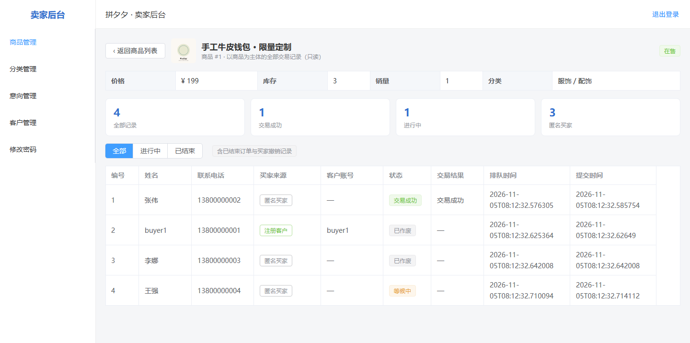
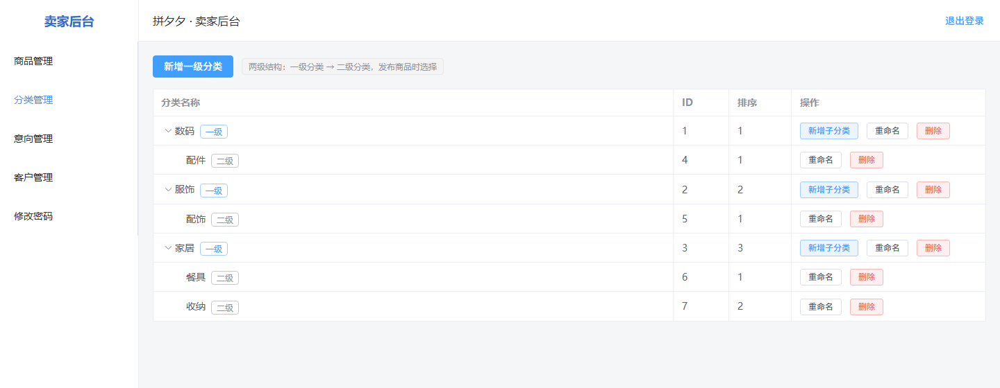

# 第 3 次阶段性评审报告

## 基本信息

- 报告期次：第 3 次
- 报告日期：2026-11-04
- 项目组号：第 4 组
- 项目名称：在线购物系统（拼夕夕 PinXixi）
- 组长：何易
- 本次主题：**卖家侧能力补齐 · 文档与实现一致**
- 汇报形式：讲述版 PPT（12 页）+ 新增接口实测 + 代码与文档走查

## 评审范围与依据

本次评审围绕两条主线组织：**「卖家侧能力补齐」**与**「文档与实现一致」**。

1. 后端重启后实测本轮三个改动点：`GET /api/seller/products/{id}/history`（按商品查交易历史）、`PUT /api/seller/categories/{id}`（分类改名/排序）、提交购买意向时的状态化拒绝提示；
2. 代码走查：提交 `7c9b48c`（交易历史）、`51a2169`（拒绝提示）、`f348b19`（分类管理）、`53801c5`（文档同步）；
3. 文档核对：需求规格说明书 FR-06-02 口径、接口清单、测试用例（新增 TC-A1-07 / TC-A1-08）、README；
4. 交付口径确认：第 2 次成果交付版本仍为 **v0.2.0（提交 `43073a6`）**，本轮内容为交付之后的增量，已在验收文档中明确标注。

## 当前迭代状态

| 里程碑 | 提交 | 日期 | 说明 |
| --- | --- | --- | --- |
| 第 2 次成果交付（v0.2.0） | `43073a6` | 2026-10-29 | 第二次成果验收的交付口径（A.1/A.2 落地于 2026-10-22 的 `4f2fde7`） |
| 卖家端商品交易历史 | `7c9b48c` | 2026-10-29 | 新增按商品查询交易历史（接口 + 页面） |
| 拒绝提示状态化 | `51a2169` | 2026-10-29 | 已下架 / 已冻结分别给出提示文案 |
| 分类管理 | `f348b19` | 2026-11-04 | 后端编辑接口 + 前端分类管理页 |
| 文档同步 | `53801c5` | 2026-11-04 | 接口清单 / 测试用例 / 需求说明同步到当前实现 |

- 本轮变更规模：`f1d2e43..53801c5` 区间（含 2 次文档提交 `381bec6` / `e09479f`）为 **15 个文件，+509 / −21**；仅计 4 次功能提交（`7c9b48c` / `51a2169` / `f348b19` / `53801c5`）为 **17 个文件，+508 / −20**。新增 **2 个接口**、**2 个前端页面**。
- 构建状态：后端 `mvn compile`、前端 `npm run build` 均通过。

## 一、本次优化总览

| 方向 | 内容 | 状态 |
| --- | --- | --- |
| ① 商品交易历史 | 按商品回看全部交易记录（含终态与买家撤销记录），区分匿名买家与注册客户 | 已完成 |
| ② 分类管理 | 补齐课程挑战 A.1-02 缺失的「编辑」能力：后端新增改名 / 排序接口，前端新增分类管理页 | 已完成 |
| ③ 体验与文档 | 拒绝提示按商品状态区分；接口清单 / 测试用例 / 需求文档同步；验收文档按 v0.2.0 口径修正 | 已完成 |

本轮共 **4 次功能提交（10-29 ~ 11-04）**，另有 2 次文档提交（`381bec6` / `e09479f`）；新增 **2 个接口**、**2 个页面**。

## 二、卖家端商品交易历史（重点一）

### 2.1 需求缺口

需求规格说明书 **FR-06-02** 要求：以商品为单位归档，每个商品下挂其全部意向流水（含进行中的等候 / 交易中，以及成功 / 失败 / 撤销等已结束记录），注册客户额外记录用户名、匿名买家仅留姓名与电话，不含口令码。

改造前，卖家只能看到全局「意向列表」，商品一旦下架，其历史记录就无法按商品回溯，已结束的记录又混在列表里，核对成本很高。

| 场景 | 原系统 | 本次优化后 |
| --- | --- | --- |
| 卖家查看某件已下架商品卖给了谁 | 无法直接查 | 商品 → 交易历史（一键进入） |
| 核对某商品成交 / 失败 / 撤销各多少 | 需人工翻列表 | 统计卡片直接给出 |
| 区分下单人是注册客户还是访客 | 字段分散 | 「买家来源」列 + 「客户账号」列 |

### 2.2 接口与数据结构

```http
GET /api/seller/products/{id}/history
Header: X-Token      # AuthInterceptor 拦截 /api/seller/**
Response: Result<List<SellerIntentView>>
```

- Service：`IntentService.historyByProduct`
- DTO：`SellerIntentView`（12 个字段），**不直接暴露实体**，避免把口令码等内部字段带出
- 排序：按 `queueTime` 升序，即先到先得的排队顺序

| 字段 | 说明 |
| --- | --- |
| `id` / `productId` | 记录编号、所属商品 |
| `buyerName` / `buyerPhone` | 买家姓名与电话（访客也保留） |
| `customerId` / `customerUsername` | 为空即匿名买家；非空为注册客户 |
| `status` / `statusLabel` | `WAITING` / `TRADING` / `SUCCEEDED` / `FAILED` / `VOID` / `CANCELED` |
| `result` / `resultLabel` | 交易结果，未出结果时为 `null` |
| `queueTime` / `createdAt` | 排队时间（先到先得依据）、提交时间 |

### 2.3 前端页面：`/seller/products/:id/history`

独立页面，从商品列表一键进入（点商品名或「交易历史」按钮）。

- 页头：返回、商品名 / 商品 #ID、状态标签、价格 / 库存 / 销量 / 分类
- 统计卡片：全部记录、交易成功、进行中、匿名买家
- 筛选：全部 / 进行中 / 已结束
- 表格列：编号、姓名、联系电话、买家来源、客户账号、状态、交易结果、排队时间


> 说明：上图为讲述版第 5 页的页面结构示意；下图为 2026-11-05 运行态实拍——同一商品下 4 条记录，覆盖成交、作废、等候三种状态，且注册客户与匿名买家分列展示。



### 2.4 实测与边界验证

后端重启后调用接口，构造匿名买家与注册客户各一条记录：

```text
GET /api/seller/products/2/history
→ code=0, count=2
  id=1  customerId=null              ← 匿名买家
  id=2  customerId=2  testbuyer01
        status=WAITING
```

验证要点：

- 匿名买家 `customerId` 为空，仅保留姓名与电话；注册客户带 `customerId` 与用户名；
- 终态记录（成交 / 失败 / 撤销 / 作废）同样返回，**不受商品当前状态影响**（已下架商品的历史仍可查）；
- 接口受 `/api/seller/**` 鉴权保护，未携带 `X-Token` 返回 **HTTP 401**。

| 边界场景 | 结果 |
| --- | --- |
| 商品不存在 | 返回业务错误，不抛 500 |
| 该商品无任何意向 | 返回空数组，前端显示「暂无交易记录」 |
| 未携带 `X-Token` | HTTP 401（未登录或登录已过期） |

## 三、分类管理（重点二）

### 3.1 从「部分满足」到「完整满足」

课程挑战 **A.1 第 2 条**要求商品支持 2 级类别管理。改造前系统已有 `Category` 实体与分类树，但后端只有「新增」「删除」两个接口，**没有重命名 / 排序能力**，前端也没有分类管理入口，只能直接调接口，属于「部分满足」。

本轮补齐后，A.1 五条要求的状态如下：

| A.1 共 5 条 | 优化前 | 优化后 |
| --- | --- | --- |
| ① 可同时发布多个商品 | 满足 | 满足 |
| ② 商品支持 2 级类别管理 | 部分满足 | **满足** |
| ③ 库存为 0 自动下架 | 满足 | 满足 |
| ④ 浏览 + 搜索两种方式 | 满足 | 满足 |
| ⑤ 多图 + 富媒体描述 | 满足 | 满足 |

### 3.2 后端改造

```http
PUT /api/seller/categories/{id}
Body: { "name": "服饰", "sort": 2 }
```

配套调整：`tree()` 补 `parentId` / `sort` 字段，使一级节点也能判断层级与排序（此前一级节点缺少这两个字段，前端无法按层级渲染与排序）。

| 校验规则 | 说明 |
| --- | --- |
| 分类必须存在 | 否则返回「分类不存在」 |
| 名称非空 | 空名称直接拒绝 |
| 同级不可重名 | 排除自身后校验，返回「同级分类已存在」 |
| 不可改层级 | 请求体不接受 `parentId`，只允许修改名称与排序 |
| 删除保护 | 一级分类下仍有子分类时拒绝删除 |

实测：改名成功返回 `code=0`；重名返回「同级分类已存在」；`mvn compile` 与 `npm run build` 均通过。

### 3.3 前端分类管理页：`/seller/categories`

树形表格，一级 / 二级分开展示，操作按层级区分。


- 列：分类名称（一级可展开）、ID、排序、操作
- 一级分类操作：『＋子分类』『重命名』『删除』；二级分类只有『重命名』『删除』
- 顶部提供「新增一级分类」入口；两级结构在发布商品时被复用（一级 → 二级下拉）



> 说明：上图为讲述版第 9 页的页面结构示意；下图为 2026-11-05 运行态实拍，展示 3 个一级分类与 4 个二级分类的完整树形结构。

## 四、体验优化：拒绝提示按商品状态区分

同一个「商品不可交易」校验分支，原来只有一句笼统提示：「商品交易中，暂不接受新的购买意向」。商品实际上已经下架时，提示「交易中」明显误导用户。

改造后按商品状态分别提示：

- `OFF_SHELF` → 「商品已下架，无法提交购买意向」
- `FROZEN` → 「商品已冻结停售，暂不接受新的购买意向」

| 商品状态 | 返回 | 提示文案 |
| --- | --- | --- |
| 已下架（商品 3） | `code=1` | 商品已下架，无法提交购买意向 |
| 已冻结（商品 1 冻结后） | `code=1` | 商品已冻结停售，暂不接受新的购买意向 |
| 在售（正常提交） | `code=0` | 返回口令码，进入排队 |

> 关于一处易误判的现象：商品 2 曾出现「已下架仍能提交」的假象，实为提交意向时**预占库存**，库存归零触发「自动下架」，两次操作的先后顺序不同所致，并非校验失效。

## 五、文档与实现对齐

本轮共同步 **4 份文档**，消除「文档说的」与「代码做的」之间的偏差。

| 文档 | 问题 | 处理 |
| --- | --- | --- |
| 构建部署与接入说明 | 接口清单只列 21 条且含错误描述 | 补全并覆盖后端全部对外端点（含交易历史、分类编辑）；修正「已有在售商品时拒绝」等过时说明 |
| 测试用例与运行说明 | 无分类管理、交易历史用例 | 新增 TC-A1-07（分类管理）、TC-A1-08（按商品查看交易历史），升级用例 12 → 14 |
| 需求规格说明书 | FR-06-02 口径与实现不符；FR-07 仍列已实现项 | FR-06-02 改为含进行中记录；范围外条目移除挑战 A 已覆盖部分 |
| README | 接口表 3 处路径错误、项目简介仍是单品单卖 | 修正 `query→track`、`restore→unfreeze`、`accept→start`；补挑战 A 现状 |

**交付口径**：第 2 次成果交付版本仍为 **v0.2.0（提交 `43073a6`）**；商品交易历史（`7c9b48c`）与分类管理（`f348b19`）为之后的增量内容，已在验收文档中明确标注，不计入 v0.2.0 的交付范围。

## 六、验证证据汇总

| 验证项 | 结论 | 证据 |
| --- | --- | --- |
| 交易历史接口 | 返回 2 条记录（匿名 1 + 注册客户 1），终态记录同样返回 | `GET /api/seller/products/2/history` → `code=0, count=2` |
| 交易历史鉴权 | 未携带 `X-Token` 返回 401 | 请求 `/api/seller/**` 受 `AuthInterceptor` 拦截 |
| 分类编辑接口 | 改名成功 `code=0`；重名返回「同级分类已存在」；层级不可改 | `PUT /api/seller/categories/{id}` 实测 |
| 拒绝提示 | 已下架 / 已冻结 / 在售三种状态提示与返回码符合预期 | 商品 3（下架）、商品 1（冻结）、正常提交流程 |
| 构建 | 后端 `mvn compile`、前端 `npm run build` 通过 | 本地构建输出 |
| 文档一致性 | 4 份文档与实现对齐，新增 TC-A1-07 / TC-A1-08 | 需求规格说明书、接口清单、测试用例、README |
| 用例执行 | 升级用例 14 项全部通过（2026-11-04 补充实测 TC-A1-07 / TC-A1-08） | 测试用例与运行说明 8.3 节 |

## 七、任务完成情况与分工

本轮以「模块归属」列示各成员承担的工作与成果物（与第二次评审的分工口径一致）：

| 完成人 | 承担工作 | 成果物 |
| --- | --- | --- |
| 方浩昱（后端②） | 交易历史：`IntentService.historyByProduct` 与 `SellerIntentView` DTO（12 字段，不暴露实体）；提交意向时按商品状态区分拒绝提示 | `service/IntentService.java`、`dto/SellerIntentView.java`、`controller/ProductController.java` |
| 王则凯（后端①） | 分类管理：`PUT /api/seller/categories/{id}` 编辑接口、同级重名校验、`tree()` 补 `parentId` / `sort`、删除保护 | `controller/CategoryController.java`、`service/CategoryService.java` |
| 丁月诚（前端） | 交易历史页（`/seller/products/:id/history`，统计卡片 + 三态筛选 + 表格）；分类管理页（`/seller/categories`，树形表格 + 新增/重命名/删除）；商品列表入口与路由 | `views/seller/ProductHistory.vue`、`views/seller/CategoryManage.vue`、`views/seller/ProductManage.vue`、`router/index.js`、`SellerLayout.vue` |
| 戴英杰（测试） | 接口实测与边界验证（鉴权 401、商品不存在、无意向、三种商品状态提示），回归 v0.2.0 主流程 | 测试结论并入《测试用例与运行说明》第八章、本报告第六章 |
| 何易（文档 / 组长） | 4 份文档同步与交付口径修正、汇报 PPT 与本次 Wiki 整理 | 需求规格说明书、构建部署与接入说明、测试用例与运行说明、README、本报告 |

> 说明：本轮 4 次提交（`7c9b48c` / `51a2169` / `f348b19` / `53801c5`）为便于统一联调合并推送，上表按模块归属拆分；如与实际分工记录有出入，以组内记录为准。

## 八、遗留问题与后续计划

当前状态：**代码与文档已对齐，主仓库与 Wiki 均已同步**。

| 类别 | 内容 |
| --- | --- |
| 待补齐 | 种子商品图片 404（`/uploads/product_10.png` 不存在，且 `backend/uploads/` 被 `.gitignore` 排除，全新克隆环境会复现） |
| 已补齐 | ① 新页面实拍截图（2026-11-05）：交易历史 `screenshots/13-product-history.png`、分类管理 `screenshots/14-category-manage.png`，均随本文嵌入；② 运行录屏（2026-11-05，2 分 06 秒），随 Release v0.3.0 附件交付 `demo-v0.3.0.mp4` |
| 版本说明 | 本页为**评审提交版**（12 页 PPT，对应 `slides/r3/`），口径以 v0.2.0（`43073a6`）为交付基线。另有一份[详细版](https://github.com/kaskk345/pingxixi-online-shoppingplatform/blob/main/docs/wiki/%E7%AC%AC3%E6%AC%A1%E9%98%B6%E6%AE%B5%E6%80%A7%E8%AF%84%E5%AE%A1%E6%8A%A5%E5%91%8A_%E8%AF%A6%E7%BB%86%E7%89%88.md)（16 页 PPT），额外覆盖 `43073a6` 库存预占复核与 2026-11-05 交易闭环现场回归，作为补充材料保留，**不替代本页口径** |
| 已完成 | 交易历史（接口 + 页面 + 实测）；分类管理（后端编辑 + 前端管理页）；4 份文档同步，主仓库与 Wiki 一致 |
| 后续方向 | 挑战 B / C / D / E；课程需求待老师陆续发布，按解锁节奏推进 |
| 演示材料 | 补录第二次演示视频，覆盖多商品、分类、库存、客户与交易历史 |
| 测试脚本 | ~~`scripts/verify-api.ps1` 仍按「唯一在售」编写~~ —— **已补齐（2026-11-05）**：多商品版 27 项断言全部通过（含预占、归零自动下架、交易历史、分类编辑），基线版留档为 `scripts/verify-api-sprint1.ps1` |

## 九、评审结论

1. **两条主线均已落地**：卖家端商品交易历史（接口 `GET /api/seller/products/{id}/history` + 页面）与分类管理（`PUT /api/seller/categories/{id}` + 管理页）完成实现，并通过接口实测；课程挑战 A.1 第 2 条由「部分满足」提升为「满足」，A.1 五条全部满足。
2. **体验问题修复可验证**：拒绝提示按 `OFF_SHELF` / `FROZEN` / 在售三种状态分别给出文案，实测返回码与提示一致。
3. **文档与实现一致**：4 份文档同步完成，新增 TC-A1-07 / TC-A1-08（升级用例 12 → 14），交付口径明确为 v0.2.0（`43073a6`），增量内容单独标注。
4. **遗留项均为材料类与工程类待办**（演示录像、页面实拍截图、种子图片、多商品版自检脚本），不影响本轮功能验收，按下一迭代排期。

## 附：汇报 PPT 逐页预览

> GitHub 不支持在线预览 .pptx，以下为本轮讲述版 PPT 逐页导出的图片（共 12 页），可直接在页面内查看。


