# 第 4 次阶段性评审报告

## 基本信息

- 报告期次：第 4 次
- 报告日期：2026-11-09
- 项目组号：第 4 组
- 项目名称：在线购物系统（拼夕夕 PinXixi）
- 组长：何易
- 本次主题：**挑战 B 首批落地 · 订单闭环与商品预选**
- 汇报形式：讲述版 PPT（12 页）+ 接口实测 + 浏览器逐页走查

## 评审范围与依据

本次评审围绕课程挑战 **B 组**的两项升级组织：**B.1 订单升级**与 **B.2 商品预选升级**。

1. 需求依据：B.1 共 3 条（订单五状态、客户在开始发货前取消、商家在交易完成前取消）；B.2 共 4 条（收藏、加入购物车、多件合并下单、购物车批量转收藏）。
2. 代码依据：提交 `4d6085b`，在上一轮交付基线 `3d8bf45`（v0.3.0）之上 rebase 后合入，未改写远端历史。
3. 验证方式：本地 H2 环境启动后端与前端，按「加购 → 多件下单 → 五状态推进 → 双向取消 → 批量转收藏」走完整链路；接口返回值、库存变化与页面状态逐项核对。
4. 交付口径：第 3 次成果交付版本仍为 **v0.3.0（`3d8bf45`）**，本轮内容为交付后的增量，单独计入第 4 次评审。

## 当前迭代状态

| 里程碑 | 提交 | 日期 | 说明 |
| --- | --- | --- | --- |
| 第 3 次成果交付（v0.3.0） | `3d8bf45` | 2026-11-05 | 上一次交付基线（挑战 A + 卖家侧能力） |
| 挑战 B 首批（本轮） | `4d6085b` | 2026-11-09 | 订单五状态 + 收藏 / 购物车 / 多件下单 / 转收藏 |
| 文档同步 | 本次提交 | 2026-11-09 | 第 4 次评审报告、讲述版 PPT、Wiki 与 README 链接 |

- 本轮变更规模：**33 个文件，+2196 / −28**；新增 **23 个接口**、**4 张表**（Order / OrderItem / CartItem / Favorite）、**1 个订单状态枚举**、**3 个新页面**。
- 构建状态：后端 `mvn package`、前端 `npm run build` 均通过；四个新页面浏览器走查无控制台报错。

## 一、本次交付总览

| 编号 | 需求 | 实现 | 状态 |
| --- | --- | --- | --- |
| B.1-1 | 订单包含客户下单、商家确认、备货完成、开始发货、交易完成 5 个状态 | `OrderStatus` 五状态 + `CANCELED` 终态；卖家按序推进，跨状态操作被拒绝 | 已完成 |
| B.1-2 | 开始发货状态前，客户可以取消订单 | `POST /api/customer/orders/{id}/cancel`；仅 `PLACED / CONFIRMED / PREPARED` 可取消 | 已完成 |
| B.1-3 | 交易完成状态前，商家可以取消订单 | `POST /api/seller/orders/{id}/cancel`；除 `COMPLETED / CANCELED` 外均可取消 | 已完成 |
| B.2-1 | 客户可以收藏商品 | 收藏 / 取消收藏 / 是否已收藏 / 收藏列表，`(customerId, productId)` 唯一 | 已完成 |
| B.2-2 | 客户可以选择商品进入购物车 | 加入、改数量、删除、清空；重复加入累加数量，数量受库存约束 | 已完成 |
| B.2-3 | 从购物车中选择多件商品进行下单 | `POST /api/customer/cart/checkout`：多件合并为一个订单，逐条价格快照 | 已完成 |
| B.2-4 | 从购物车中选择多件商品转为收藏 | `POST /api/customer/cart/to-favorites`：批量写收藏并移除购物车条目 | 已完成 |

> 说明：原有「购买意向排队 + 口令码」能力**保留**，用于线下交易场景；本轮订单链路独立建表，两者互不影响。

## 二、B.1 订单升级

### 2.1 五状态与流转规则

| 状态 | 枚举 | 含义 | 可执行的下一步 |
| --- | --- | --- | --- |
| 客户下单 | `PLACED` | 订单已生成，库存已扣减 | 商家确认 / 客户取消 / 商家取消 |
| 商家确认 | `CONFIRMED` | 商家接单 | 备货完成 / 客户取消 / 商家取消 |
| 备货完成 | `PREPARED` | 商品已备好 | 开始发货 / 客户取消 / 商家取消 |
| 开始发货 | `SHIPPED` | 已发出，客户不可再取消 | 交易完成 / 商家取消 |
| 交易完成 | `COMPLETED` | 终态，累计销量 | 无 |
| 已取消 | `CANCELED` | 终态，记录取消方与原因 | 无 |

实现位于 `entity/enums/OrderStatus.java`，用枚举方法表达规则，避免控制器里散落 if-else：

```java
public boolean cancellableByCustomer() {   // 开始发货之前
    return this == PLACED || this == CONFIRMED || this == PREPARED;
}

public boolean cancellableBySeller() {     // 交易完成之前
    return this != COMPLETED && this != CANCELED;
}
```

### 2.2 两条取消规则的落地

| 角色 | 可取消窗口 | 接口 | 取消后处理 |
| --- | --- | --- | --- |
| 客户 | 客户下单 / 商家确认 / 备货完成 | `POST /api/customer/orders/{id}/cancel` | 订单置 `CANCELED`，`canceledBy=CUSTOMER`，库存逐项回滚 |
| 商家 | 交易完成之前的四个状态 | `POST /api/seller/orders/{id}/cancel` | 订单置 `CANCELED`，`canceledBy=SELLER`，记录原因，库存回滚 |

取消统一走 `OrderService.doCancel`：写入 `canceledAt / canceledBy / cancelReason`，再按订单明细把 `quantity` 加回对应商品库存；若商品此前因库存归零自动下架，库存恢复为正数时重新上架；销量只在交易完成时累加，取消不扣减销量。

### 2.3 数据模型

| 实体 | 表名 | 关键字段 |
| --- | --- | --- |
| `Order` | `mall_order` | `orderNo`（唯一）、`customerId`、`buyerName`、`buyerPhone`、`address`、`remark`、`totalAmount`、`itemCount`、`status`、`canceledBy`、`cancelReason`、各节点时间 |
| `OrderItem` | `order_item` | `orderId`、`productId`、`productName`、`productImage`、`price`、`quantity`、`subtotal` |
| `CartItem` | `cart_item` | `customerId + productId` 唯一、`quantity` |
| `Favorite` | `favorite` | `customerId + productId` 唯一 |

- `OrderItem` 保存**名称 / 图片 / 单价快照**，卖家后续改价、改名不影响历史订单金额。
- `Order` 记录 `createdAt / confirmedAt / preparedAt / shippedAt / completedAt / canceledAt`，状态变化全程可追溯。
- 订单号规则：`SO + yyyyMMddHHmmss + 4 位随机数`，数据库唯一约束兜底，冲突自动重试。

### 2.4 接口一览

| 端 | 方法 | 路径 | 说明 |
| --- | --- | --- | --- |
| 客户 | GET | `/api/customer/orders` | 订单列表（含明细、节点时间、可取消标记） |
| 客户 | GET | `/api/customer/orders/{id}` | 订单详情（仅本人） |
| 客户 | POST | `/api/customer/orders/{id}/cancel` | 取消订单（开始发货前） |
| 卖家 | GET | `/api/seller/orders` | 订单列表（`status` 筛选 + 分页） |
| 卖家 | GET | `/api/seller/orders/{id}` | 订单详情 |
| 卖家 | POST | `/api/seller/orders/{id}/confirm` | `PLACED → CONFIRMED` |
| 卖家 | POST | `/api/seller/orders/{id}/prepare` | `CONFIRMED → PREPARED` |
| 卖家 | POST | `/api/seller/orders/{id}/ship` | `PREPARED → SHIPPED` |
| 卖家 | POST | `/api/seller/orders/{id}/complete` | `SHIPPED → COMPLETED` |
| 卖家 | POST | `/api/seller/orders/{id}/cancel` | 取消订单（交易完成前） |

鉴权沿用现有拦截器：`/api/customer/**` 校验客户 token，`/api/seller/**` 校验卖家 token。

### 2.5 下单事务：一次请求完成 5 件事

```java
@Transactional
public OrderView checkoutFromCart(customerId, itemIds, buyerName, ...) {
    // 1. 校验购物车条目属于当前客户
    // 2. 逐项校验商品可购买 + 库存充足
    // 3. 扣减库存；库存归零自动下架
    // 4. 生成 Order + OrderItem（价格快照）
    // 5. 删除已下单的购物车条目
}
```

- 任一步失败抛 `BizException`，事务整体回滚，不会出现「订单生成了但库存没扣」或「库存扣了但订单没生成」。
- 商品实体保留 `@Version` 乐观锁，库存随实体更新，并发修改时由 JPA 校验版本。
- 下单即扣库存（而非发货时扣），保证「订单成立 = 库存已锁定」；与既有意向预占的库存口径一致。

### 2.6 卖家端订单管理页（`/seller/orders`）

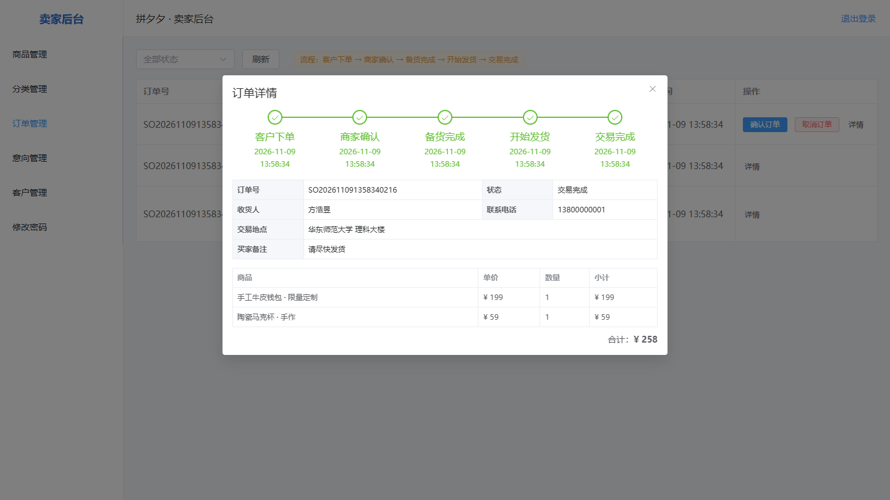

- 状态筛选覆盖五个状态与已取消，列表按创建时间倒序分页。
- 操作列按当前状态只显示唯一「下一步」按钮：确认订单 / 备货完成 / 开始发货 / 交易完成，避免跳步。
- 「取消订单」在交易完成前显示，弹窗填写取消原因，成功后库存自动回滚。
- 「详情」弹窗展示五节点进度、收货信息、商品明细与合计。

### 2.7 客户订单页（`/customer/orders`）

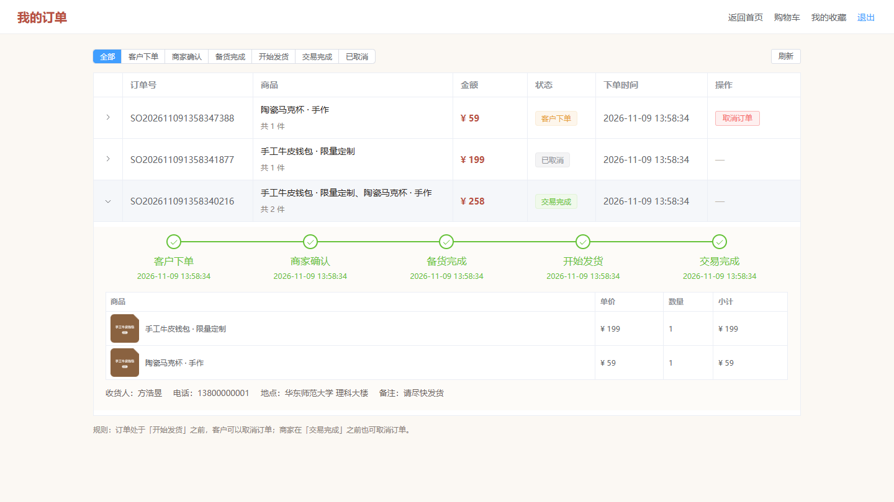

- 状态页签：全部 / 客户下单 / 商家确认 / 备货完成 / 开始发货 / 交易完成 / 已取消。
- 展开行显示五节点时间轴（客户下单 → 商家确认 → 备货完成 → 开始发货 → 交易完成）、商品明细、收货信息。
- 「取消订单」按钮仅在前三个状态出现；取消需二次确认并可填写原因，成功后页面与库存同步刷新。
- 已取消订单保留完整明细，显示取消方与原因。

### 2.8 实测记录

```text
POST /api/customer/cart/checkout  { itemIds:[钱包, 马克杯], ... }
→ orderNo = SO202611091353017504
  status  = PLACED   totalAmount = 258.00   items = 2
POST /api/seller/orders/{id}/confirm → CONFIRMED
POST /api/seller/orders/{id}/prepare → PREPARED
POST /api/seller/orders/{id}/ship    → SHIPPED
POST /api/customer/orders/{id}/cancel
→ code=1  「订单已开始发货，无法取消」（状态保持 SHIPPED）
POST /api/seller/orders/{id}/complete → COMPLETED，商品 sales +1
```

另一笔订单在 `PLACED` 状态由客户取消：订单变为 `CANCELED`，商品库存由 `0` 恢复为 `1`，状态恢复在售；再一笔订单在 `CONFIRMED` 状态由商家取消，`canceledBy=SELLER`，取消原因与库存回滚均符合预期。

## 三、B.2 商品预选升级

### 3.1 收藏（`/favorites`）

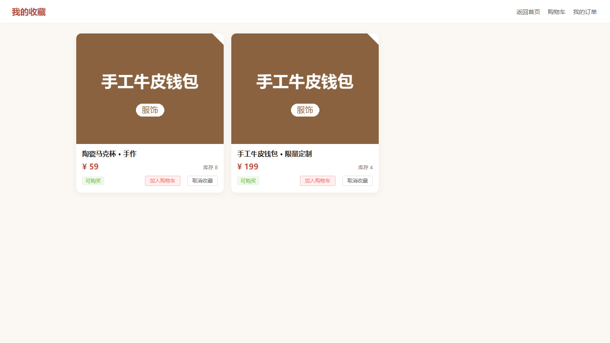

- 收藏关系只存 `(customerId, productId)`，重复收藏不新增记录；实测重复收藏后收藏总数保持不变。
- 收藏列表展示时联表读取商品**当前**价格、库存与状态，避免商品改价后收藏页显示过期价格。
- 商品不可购买时「加入购物车」置灰，但仍可取消收藏。
- 商品详情页提供「收藏 / 已收藏」切换；首页商品卡提供快捷收藏入口。

### 3.2 购物车（`/cart`）

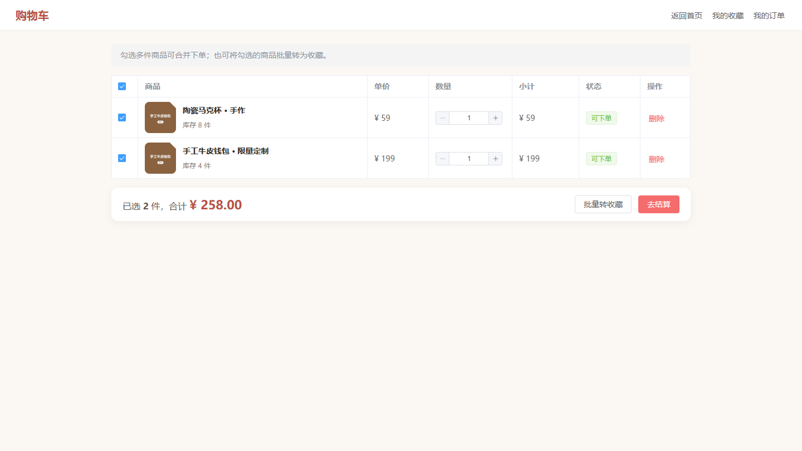

- 同一客户同一商品只保留一条记录，重复加入累加数量。
- 数量步进器即时校验库存：超过库存返回「库存不足，仅剩 N 件」，超过单件上限返回「单件商品最多购买 99 件」。
- 支持修改数量、删除单条、清空购物车；不可购买商品的条目标记为「不可购买」，不可勾选结算。

### 3.3 多件商品合并下单

- 勾选购物车中多件商品 → 结算弹窗（默认带出客户资料，可改收货人、电话、交易地点、备注）→ 生成**一个订单 + N 条订单明细**。
- 下单成功后对应购物车条目自动删除，并跳转「我的订单」；返回订单号便于核对。
- 总金额为各明细小计之和，价格为下单时快照；下单同时扣减各商品库存，库存归零自动下架。

### 3.4 购物车批量转收藏

```http
POST /api/customer/cart/to-favorites
Body: { "itemIds": [12, 13, 14] }
Response: 3   // 实际转移条数
```

- 勾选多条后一键转收藏：已在收藏中的商品跳过创建，但同样从购物车移除。
- 与多件下单共用同一套勾选结果：现在买 → 合并下单；以后再买 → 批量转收藏。
- 购物车条目在任一通道完成后都会被移除，避免重复下单。

## 四、边界与一致性验证

| 验证项 | 实测输入 | 结果 |
| --- | --- | --- |
| 数量超过单件上限 | 购物车加入 999 件 | `code=1`「单件商品最多购买 99 件」 |
| 数量超过库存 | 加入 50 件（库存 8） | `code=1`「库存不足，仅剩 8 件」 |
| 不可购买商品加购 | 已下架商品 | `code=1`「商品当前不可购买」 |
| 空勾选下单 | `itemIds=[]` | `code=1`「请选择要下单的商品」 |
| 空勾选转收藏 | `itemIds=[]` | `code=1`「请选择商品」 |
| 重复收藏 | 再次收藏同一商品 | 收藏总数不变，不产生重复记录 |
| 发货后客户取消 | `SHIPPED` 订单 | `code=1`「订单已开始发货，无法取消」，状态不变 |
| 交易完成后商家取消 | `COMPLETED` 订单 | `code=1`「订单已交易完成，无法取消」 |
| 重复取消 | `CANCELED` 订单 | `code=1`「订单已取消，无需重复操作」 |
| 未登录访问客户接口 | 不带 `X-Token` | HTTP 401 |
| 客户访问他人订单 | 他人订单 ID | 「订单不存在」（按 `customerId` 过滤） |

## 五、构建与页面走查

| 项目 | 结果 |
| --- | --- |
| 后端构建 | `mvn -q -DskipTests package` 成功 |
| 前端构建 | `npm run build` 成功（Vite 产物正常） |
| 购物车页 | 渲染正常，勾选、数量步进、汇总金额无异常 |
| 收藏页 | 渲染正常，可购买状态与按钮置灰逻辑正确 |
| 客户订单页 | 三种状态并存，展开时间轴、明细与取消按钮符合状态规则 |
| 卖家订单页 | 列表、筛选、详情弹窗、推进按钮与取消按钮符合状态规则 |
| 浏览器控制台 | 上述四页均无 error 级日志 |

## 六、任务完成情况与分工

| 完成人 | 承担工作 | 成果物 |
| --- | --- | --- |
| 方浩昱（后端②） | 订单状态机与取消规则、下单事务与库存回滚、购物车 / 收藏服务、接口实测 | `OrderStatus`、`OrderService`、`CartService`、`FavoriteService`、订单三控制器 |
| 王则凯（后端①） | 订单 / 明细 / 购物车 / 收藏数据模型与 Repository、订单号规则、卖家订单分页查询 | `Order`、`OrderItem`、`CartItem`、`Favorite`、4 个 Repository、`SellerOrderController` |
| 丁月诚（前端） | 购物车页、收藏页、客户订单页重构、卖家订单管理页、首页 / 详情入口与路由菜单 | `Cart.vue`、`Favorites.vue`、`CustomerOrders.vue`、`OrderManage.vue`、`Home.vue`、`ProductDetail.vue`、`router/index.js` |
| 戴英杰（测试） | B.1 状态边界（发货后禁取消、完成后禁取消、重复取消）、B.2 预选链路与库存一致性实测、四页界面走查 | 本报告第四章、第五章 |
| 何易（文档 / 组长） | 需求对齐、第 4 次评审报告与讲述版 PPT、Wiki 与 README 同步 | 本报告、`docs/media/第四周_第四次评审_讲述版.pptx`、Wiki 首页 |

> 说明：本轮代码为一次性联调提交 `4d6085b`，上表按模块归属拆分；如与实际分工记录有出入，以组内记录为准。

## 七、遗留问题与后续计划

| 类别 | 内容 | 影响 / 计划 |
| --- | --- | --- |
| 物流信息 | 「开始发货」目前只有状态，没有物流单号、承运商与轨迹 | 不影响 B.1 验收；下一迭代补 `shipmentNo / carrier` 字段与录入入口 |
| 地址簿 | 下单时手填收货信息，未沉淀为常用地址 | 计划新增客户地址表与默认地址选择 |
| 支付 | 仍为线下交易，订单无支付状态与流水 | 与项目「线下交易」基线一致，暂不引入在线支付 |
| 库存并发 | 依赖 `@Version` 乐观锁，未做并发压测 | 下一迭代补并发下单压测与失败重试提示 |
| 统计看板 | 订单量、取消率、热销商品未做可视化 | 后端可基于现有表聚合，前端排入后续迭代 |
| 商品图片 | 种子商品图片 `product_10.png` 在全新克隆环境仍 404 | 历史遗留，计划把示例图纳入仓库或改用占位图 |
| 文档同步 | 需求规格说明书、测试用例尚未补 B.1 / B.2 条目 | 下一迭代与功能同步更新，避免文档再次落后于实现 |

## 八、评审结论

1. **挑战 B 首批 7 条需求全部落地**：订单五状态、客户取消、商家取消、收藏、购物车、多件合并下单、批量转收藏，均有接口与页面支撑。
2. **规则边界可验证**：开始发货后客户取消被拒绝，交易完成后商家取消被拒绝，重复取消被拒绝；取消后库存回滚正确。
3. **下单事务自洽**：多件商品合并为一个订单，明细价格快照、库存扣减、购物车清理在同一事务内完成，实测订单金额与库存变化一致。
4. **页面闭环完整**：客户侧「浏览 → 收藏 / 加购 → 合并下单 → 查看进度 → 条件取消」全链路可用；卖家侧「查看 → 确认 → 备货 → 发货 → 完成 / 取消」全链路可用。
5. **对既有能力无破坏**：在 v0.3.0 基础上 rebase 合入，挑战 A 与意向排队流程未回归失败；后端打包与前端构建均通过。

## 附：汇报 PPT 与逐页预览

- 讲述版 PPT：[第四周_第四次评审_讲述版.pptx](https://github.com/kaskk345/pingxixi-online-shoppingplatform/blob/main/docs/media/第四周_第四次评审_讲述版.pptx)
- PDF 版：[第四周_第四次评审_讲述版.pdf](https://github.com/kaskk345/pingxixi-online-shoppingplatform/blob/main/docs/media/第四周_第四次评审_讲述版.pdf)

> GitHub 不支持在线预览 .pptx，以下为讲述版逐页导出的图片（共 12 页），可直接在页面内查看。

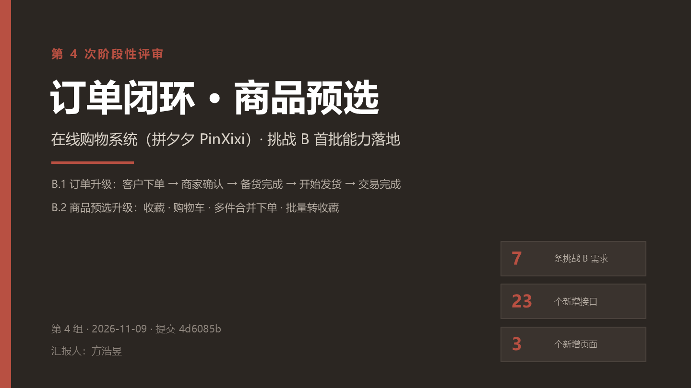

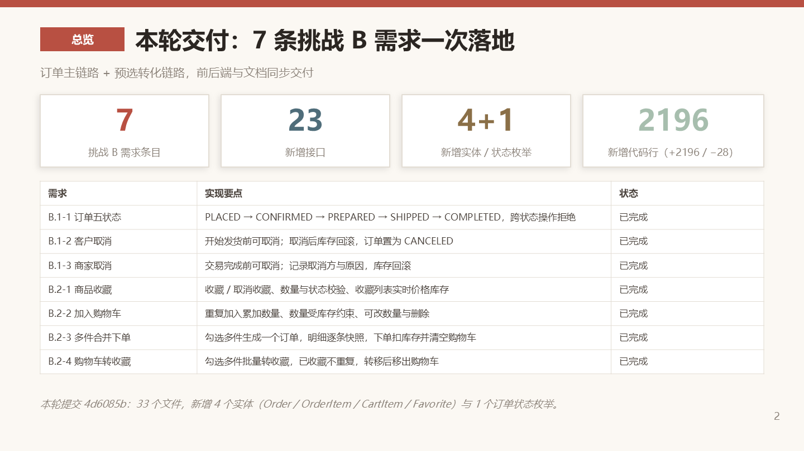

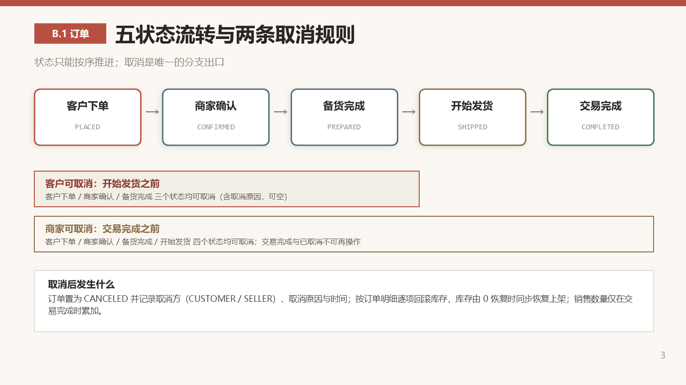

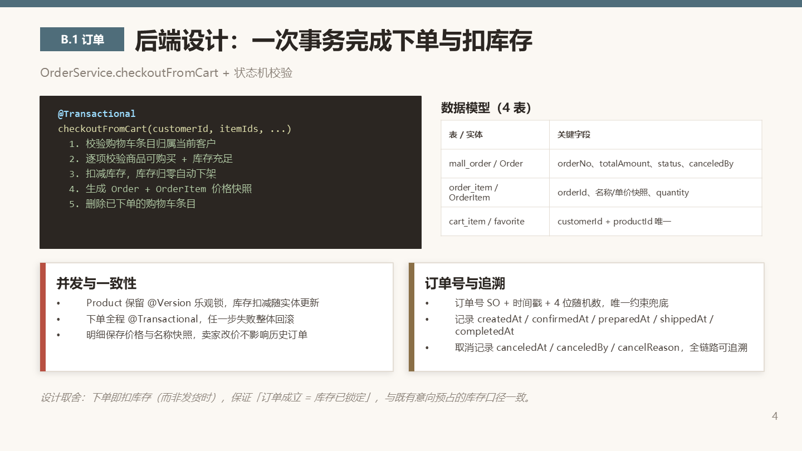

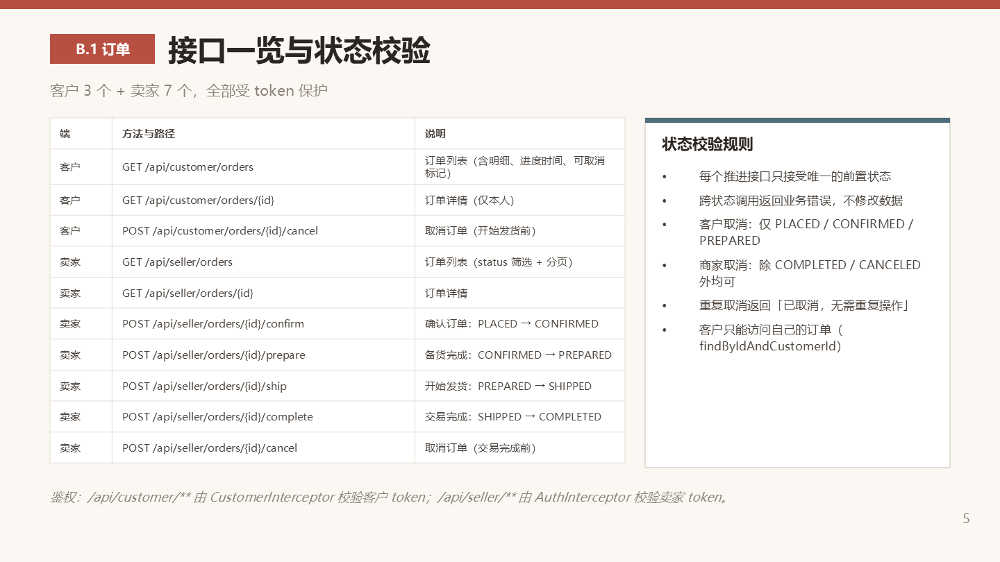

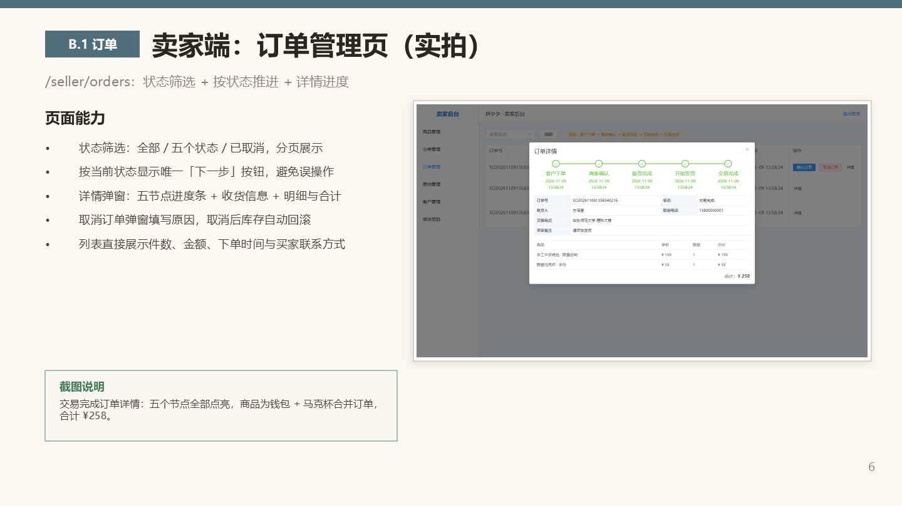

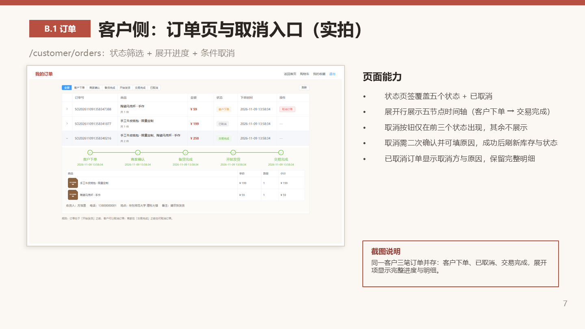

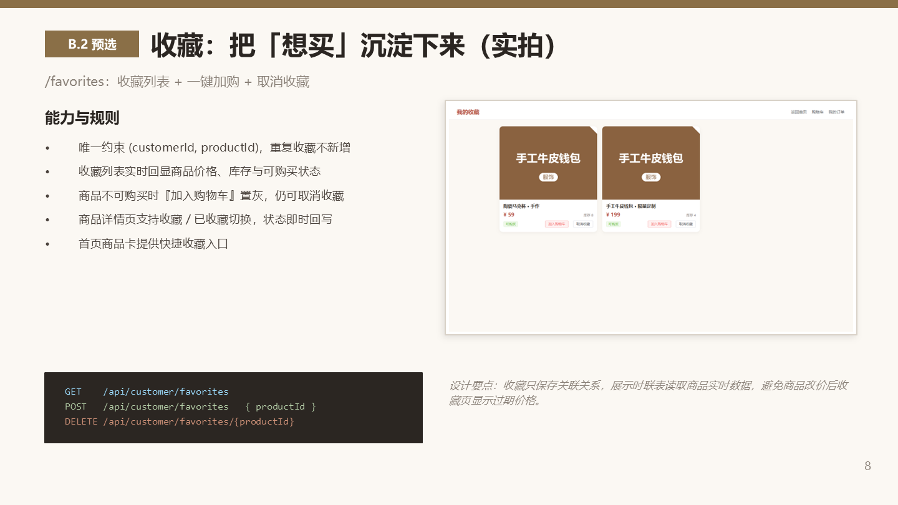

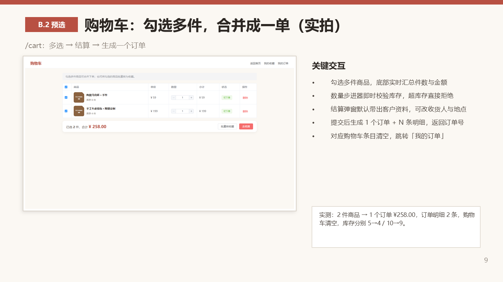

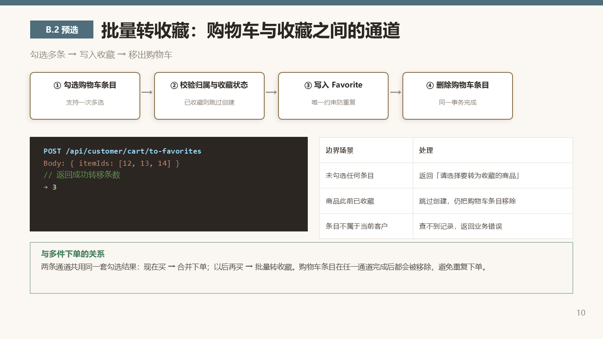

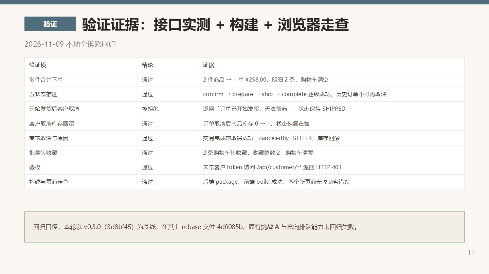

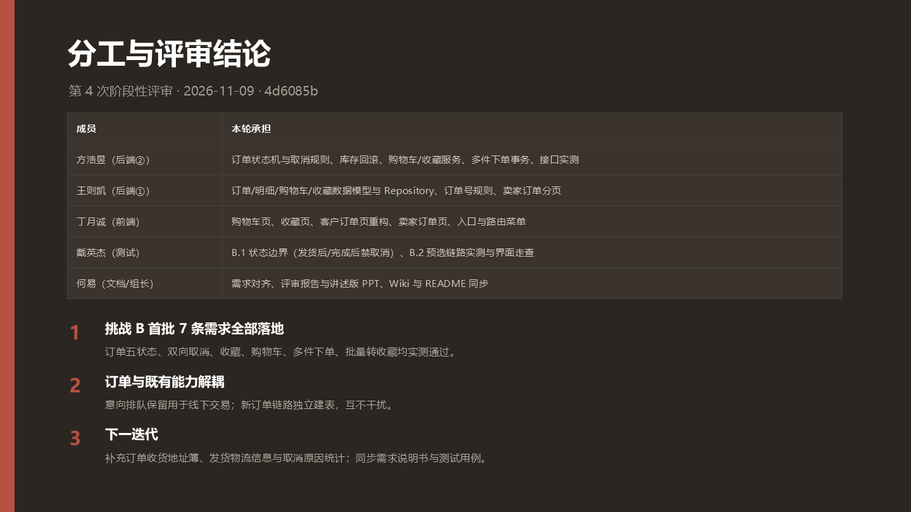
